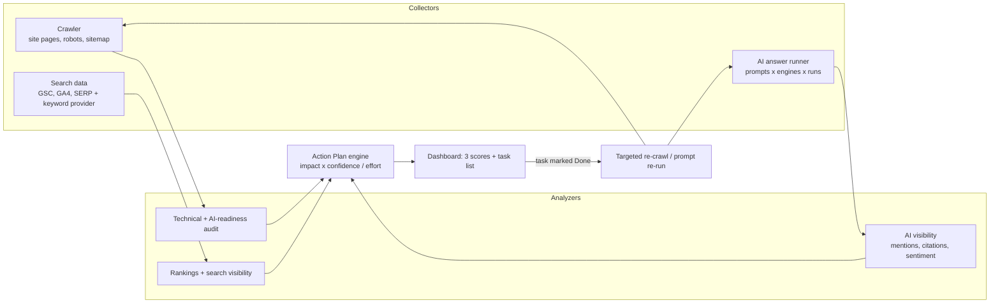

# SEO + GEO Platform — PRD

Oct 7, 2026 · @Spencer · Status: Draft v0.1 (planning)

Source of truth: the Claude Docs page "SEO + GEO Platform — PRD"
(https://claude.ai/artifact/7zyrTCRC2rRgvtRofEpvmn). This file is a snapshot of rev 11, copied
into the repo on Oct 8, 2026. If the two disagree, update this file from the doc.

Repo: [spencertownley-sys/SEOBuilder](https://github.com/spencertownley-sys/SEOBuilder)

## Overview

One workspace that tells a site owner how visible they are in classic search (SEO) and in AI answers (GEO: generative engine optimization), and gives them a ranked, plain-English fix list for both.

**Problem.** Search is splitting in two. People still use Google, but more of them now ask ChatGPT, Claude, Perplexity, Gemini and Google's AI Overviews, which answer directly and cite only a few sources. Existing SEO suites (Ahrefs, Semrush, Moz) are built for keyword rankings and are complex. GEO tools are new, narrow, and rarely tell you *what to change*.

**Target users.** Small business owners, solo marketers, freelancers and agencies managing 1 to 50 sites, content creators, and in-house marketers at mid-size brands.

**SEO vs GEO in this product**

|  | SEO | GEO |
| --- | --- | --- |
| Goal | Rank higher in search results | Get mentioned and cited in AI answers |
| Measured by | Keyword positions, clicks, impressions | Mention rate, citation rate, position in answer, sentiment, share of voice per prompt |
| Levers | Technical health, content, links, local profile | Clear factual content, structured data, entity consistency, third-party mentions, crawlable by AI bots, citable stats and quotes |

**Positioning.** "Be found by people and by AI." A guided action plan instead of a wall of metrics.

**Working name.** TBD (placeholder: *Rankwell*).

## Goals, non-goals, success metrics

**Goals (v1)**

- Connect a site and get a combined SEO + AI Visibility score with a prioritized fix list in under 10 minutes.
- Track a site's mentions and citations across major AI assistants for a set of prompts the user cares about.
- Turn every finding into a concrete task with an estimated impact and effort.
- Show progress over time so users see what their fixes changed.

**Non-goals (v1)**

- Building or hosting websites.
- Buying links or any black-hat tactics; no automated link spam or fake reviews.
- Guaranteeing rankings or AI citations.
- Full backlink index of our own (we license data instead).

**Success metrics**

| Metric | Target (6 months post-launch) |
| --- | --- |
| Time from signup to first action plan | under 10 minutes |
| Users completing 3+ recommended tasks in month 1 | 50% |
| Sites showing improved AI mention rate after 60 days | 40% |
| Paid conversion from free audit | 8% |
| Monthly logo churn | under 5% |

## Personas and core use cases

| Persona | Main question | What they need from us |
| --- | --- | --- |
| Local business owner (e.g. a photographer) | "Why don't I show up when people search or ask AI for someone like me nearby?" | Local SEO checks, Google Business Profile tips, AI prompt tracking like "best wedding photographer in Tacoma" |
| Solo marketer / freelancer | "What should I fix first?" | Prioritized task list, content briefs, simple reports to show clients |
| Agency | "How are my 30 clients doing, and what moved?" | Multi-site workspace, white-label reports, alerts |
| Content creator / publisher | "Which of my articles get cited by AI, and which should?" | Page-level AI citation tracking, content optimization scores |
| In-house brand marketer | "Are AI assistants describing our brand correctly vs competitors?" | Share of voice in AI answers, brand-accuracy monitoring, sentiment |

**Core use cases**

1. Run a free site audit and get a score plus top 10 fixes.
2. Track keyword rankings in Google and Bing.
3. Track AI visibility: for a set of prompts, does each AI assistant mention or cite my brand, and where?
4. Compare against competitors in both search and AI answers.
5. Optimize a page: paste a URL and get SEO + GEO rewrite suggestions.
6. Plan content: find questions people ask that nobody answers well.
7. Catch AI getting facts wrong about the brand (wrong prices, hours, products).

## Functional requirements: SEO module

Priority: **P0** = MVP, **P1** = fast follow, **P2** = later.

**Site setup**

- P0: Add a site by URL; verify ownership (DNS TXT or meta tag); connect Google Search Console and Google Analytics 4 via OAuth.
- P0: Onboarding asks business type, location(s), main services/products, and 3 competitors (AI suggests them).

**Technical audit (crawler)**

- P0: Crawl up to 500 pages (more on paid plans): broken links, redirects, status codes, titles and meta descriptions, headings, duplicate content, canonical tags, image alt text, internal linking, sitemap and robots.txt.
- P0: Page speed and Core Web Vitals via PageSpeed Insights API.
- P1: Structured data validation (schema.org), hreflang, mobile usability, JavaScript rendering checks.
- P1: Scheduled re-crawls (weekly) with "new issues" and "fixed issues" diff.

**Keywords and rankings**

- P0: Keyword research: search volume, difficulty, intent, related questions (licensed data provider).
- P0: Rank tracker for up to N keywords, by location and device, daily or weekly.
- P1: Search Console import: real clicks, impressions, CTR, queries per page.
- P1: Keyword gap vs competitors; cannibalization detection.

**Content**

- P1: Page optimizer: score a URL against a target keyword (coverage, structure, readability, entities).
- P1: AI content brief: outline, questions to answer, recommended length, internal links.
- P2: Content decay alerts (pages losing traffic).

**Backlinks and authority**

- P1: Backlink overview from a licensed index: referring domains, new/lost links, anchor text.
- P2: Outreach suggestions (unlinked brand mentions, broken-link opportunities).

**Local SEO**

- P1: Google Business Profile checks (categories, hours, photos, reviews, posts) and NAP consistency (name, address, phone) across directories.
- P2: Local rank grid (ranking from many points around a city).

## Functional requirements: GEO / AI visibility module

The GEO module answers one question: when people ask AI assistants about my category, do they mention me, cite me, and describe me correctly?

**Prompt sets**

- P0: User defines a prompt set (e.g. "best photo booth rental in Seattle", "how much does a wedding photographer cost in Tacoma"). AI suggests 20 to 50 prompts from the site's services, location and competitors.
- P0: Prompts grouped by intent: discovery ("best X"), comparison ("X vs Y"), how-to, pricing, brand ("is X legit?").
- P1: Import real questions from Search Console, Reddit and People Also Ask.

**AI answer tracking**

- P0: Run each prompt on a schedule across tracked engines: ChatGPT, Claude, Gemini, Perplexity, Google AI Overviews/AI Mode, Microsoft Copilot (engine list configurable as APIs allow).
- P0: For each answer, store the full text and extract: brand mentioned (yes/no), position in answer, cited URLs, competitors mentioned, sentiment toward brand.
- P0: Metrics per engine and overall: **mention rate**, **citation rate**, **average position**, **share of voice vs competitors**, **sentiment**.
- P1: Run variants (location, repeated runs) to account for answer randomness; report a confidence range rather than one number.
- P1: Source analysis: which third-party sites AI engines cite most for this topic (review sites, Reddit, directories, news), so users know where to earn mentions.

**Brand accuracy**

- P1: User enters brand facts (prices, hours, services, founders, locations). We flag AI answers that contradict them.

**AI readiness audit (on-site)**

- P0: Check that AI crawlers (e.g. GPTBot, ClaudeBot, PerplexityBot, Google-Extended) are not blocked unintentionally in robots.txt or by the CDN.
- P0: Content is readable without JavaScript; key facts are in text, not images.
- P1: Structured data coverage (Organization, LocalBusiness, Product, FAQ, Article, Person); entity consistency across site, Google Business Profile, Wikipedia/Wikidata, social profiles.
- P1: "Citability" score per page: clear answers near the top, specific facts and numbers, dated updates, author credentials, quotable sentences.
- P2: Optional llms.txt generation (an emerging convention; impact unproven).

**GEO page optimizer**

- P1: Paste a URL and a target prompt; get rewrite suggestions: add a direct answer paragraph, a comparison table, an FAQ, cited stats, author bio.

## Recommendations engine, reporting, workflow

The heart of the product is the **Action Plan**: every audit finding, ranking drop and AI-visibility gap becomes a task, scored and sorted so the user always knows the next best thing to do.

**Task scoring**

- Each task gets **Impact** (1 to 5), **Effort** (1 to 5), **Confidence**, and the module it helps (SEO, GEO, or both).
- Priority = impact × confidence ÷ effort; tasks that help both SEO and GEO get a boost.
- Each task explains *why* in one sentence, shows the evidence (the page, the AI answer), and gives step-by-step instructions or an AI-drafted fix (new title tag, FAQ block, schema JSON-LD).

**Workflow**

- P0: Task list with status (To do, In progress, Done, Ignored); marking Done triggers a re-check.
- P1: Assign tasks to teammates; export to Trello/Asana/Jira; comments.
- P1: "What changed" timeline linking completed tasks to ranking and AI-visibility movement.

**Dashboards and scores**

- P0: Overview with three scores (0 to 100): **Technical Health**, **Search Visibility**, **AI Visibility**; trend over time.
- P0: Competitor comparison on the same three scores.
- P1: Per-engine AI view (e.g. strong in Perplexity, absent in ChatGPT).

**Reports and alerts**

- P1: Monthly PDF/shareable link report; agency white-label.
- P1: Alerts: site down, big ranking drop, AI crawler newly blocked, brand dropped out of AI answers, AI stating a wrong fact.

## System architecture, data sources, data model

Three collectors (crawler, search data, AI answer runner) feed three analyzers, and all findings flow into one Action Plan engine. Marking a task Done schedules a targeted re-crawl or prompt re-run to confirm the fix.

*(The doc embeds this as an interactive diagram titled "SEO + GEO pipeline · 3 data sources, 1 action engine"; the Mermaid above is a reconstruction for the repo.)*

The AI answer runner is the most novel and most costly part: each tracked prompt is run on each engine several times per cycle, then parsed by an LLM into mentions, citations, position and sentiment.

**External data sources (to evaluate)**

| Need | Options |
| --- | --- |
| Keyword volume, SERPs, backlinks | DataForSEO, Semrush API, Ahrefs API (license one) |
| Site performance | Google PageSpeed Insights API |
| Real search performance | Google Search Console API, GA4 Data API, Bing Webmaster API |
| AI answers | OpenAI, Anthropic, Google Gemini, Perplexity APIs; AI Overviews via SERP provider |
| Local | Google Business Profile API |

**Core data model**

| Entity | Key fields |
| --- | --- |
| Workspace | id, plan, seats, white-label settings |
| Site | id, workspace_id, domain, verified, business type, locations, brand facts (JSON) |
| Competitor | site_id, domain, name |
| Crawl | site_id, started_at, pages_crawled, status |
| Page | crawl_id, url, status_code, title, meta, headings, schema types, word count, CWV metrics |
| Issue | page_id or site_id, type, severity, module (SEO/GEO), first_seen, resolved_at |
| Keyword | site_id, term, location, device, volume, difficulty |
| RankSnapshot | keyword_id, date, position, url, SERP features |
| Prompt | site_id, text, intent group, location |
| AIRun | prompt_id, engine, model, run_at, answer_text |
| AIMention | ai_run_id, entity (brand or competitor), mentioned, position, cited_urls[], sentiment, fact_errors[] |
| Task | site_id, source issue/mention, title, why, steps, impact, effort, confidence, status, assignee |
| ScoreSnapshot | site_id, date, technical, search, ai_visibility |

**Suggested stack (starting point)**

- Frontend: Next.js + Tailwind; Recharts for trends.
- Backend: Supabase (Postgres, auth, row-level security) + worker services on Railway.
- Crawler: headless Chromium (Playwright) workers behind a queue.
- Scheduling: queue + cron for crawls, rank checks and prompt runs.
- AI: an LLM for answer parsing, task drafting and content briefs.
- Billing and email: Stripe, Resend.

## Non-functional, compliance

- **Crawler etiquette:** obey robots.txt for sites we don't own; identify our bot by user agent; rate-limit to protect small sites.
- **AI engine access:** use official APIs where they exist; where tracking requires the consumer interface, check each provider's terms first. Label clearly that API answers can differ from what users see in the app.
- **Data accuracy:** show sample size and run dates on every AI-visibility number; never present one run as fact.
- **Scale (v1 target):** 1,000 sites, 50,000 tracked keywords, 25,000 AI prompts run weekly.
- **Security:** OAuth tokens (Search Console, GA4) encrypted; per-workspace isolation; SOC 2 later for agencies.
- **Privacy:** GDPR/CCPA; we store site data, not end-user personal data.
- **Honesty in marketing:** no ranking guarantees; impact estimates labelled as estimates.

## Monetization, roadmap, risks, open questions

**Pricing hypothesis**

| Plan | Price / month | Sites | Keywords tracked | AI prompts / week | Extras |
| --- | --- | --- | --- | --- | --- |
| Free audit | $0 | 1 | 10 | 10 (one engine) | One-time audit + top 10 fixes |
| Starter | $29 | 1 | 100 | 50, 3 engines | Action plan, weekly crawl |
| Growth | $99 | 5 | 500 | 250, all engines | Competitors, content briefs, brand accuracy |
| Agency | $299+ | 25+ | 2,500+ | 1,500+ | White-label reports, team seats, API |

AI prompt runs and keyword data are the main variable costs; plan limits should be set after measuring cost per prompt run per engine.

**Phased roadmap**

1. **Phase 0 — Validate (4 weeks):** interview 15 small businesses and 5 agencies; manual "AI visibility report" for 10 sites to test willingness to pay; price out data providers and LLM API costs.
2. **Phase 1 — MVP (10 weeks):** site setup, technical audit, AI readiness audit, prompt sets + AI answer tracking on 3 engines, Action Plan, three scores.
3. **Phase 2 — Beta (6 weeks):** rank tracking, Search Console import, competitor comparison, Stripe billing, email reports.
4. **Phase 3 — Launch:** all engines, page optimizer, content briefs, brand accuracy alerts.
5. **Phase 4 — Scale:** agencies (white-label, seats), backlinks, local rank grid, public API.

**Risks**

- AI answers are non-deterministic, so scores look noisy. Mitigation: repeated runs, confidence ranges, trend over single numbers.
- AI providers restrict automated querying or change APIs. Mitigation: official APIs first, diversify engines, follow terms.
- Crowded SEO market. Mitigation: lead with GEO + a simple action plan for small businesses, not keyword tables.
- GEO best practices are still unproven. Mitigation: measure before/after on our own customers and publish findings.
- Data costs (keywords, backlinks) squeeze margins. Mitigation: license one provider, cache aggressively, gate heavy features to higher plans.

**Open questions**

- [ ] Launch as GEO-first (narrower, more novel) or full SEO + GEO suite?
- [ ] Which keyword/backlink data provider to license?
- [ ] Self-serve only, or a done-for-you service tier for small businesses?
- [ ] Final product name and domain.
