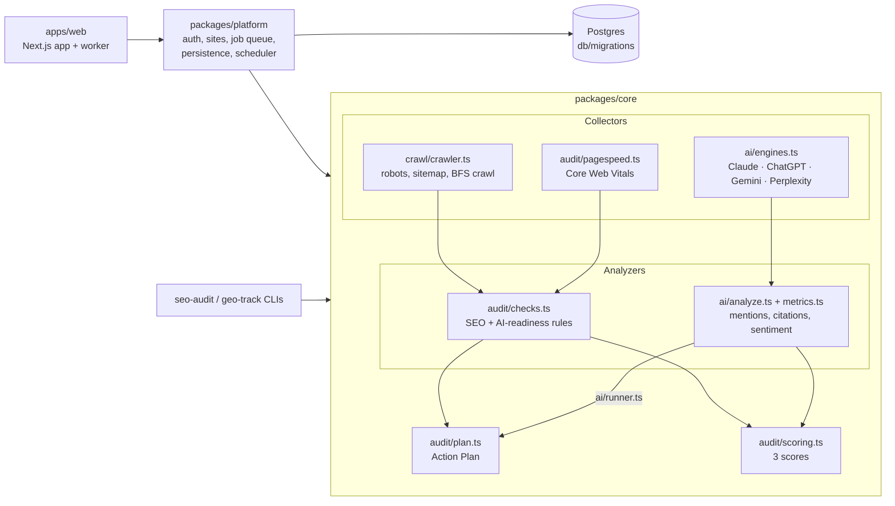

# Architecture

How the PRD's "three collectors → three analyzers → one Action Plan" design maps onto this
repo, what's built, and what's next. Read [PRD.md](PRD.md) first.

## Packages

| Path | What it is |
| --- | --- |
| `packages/core` | Framework-free TypeScript library: crawler, audit rules, scoring, Action Plan, GEO tracking. Everything else is a thin shell over it. |
| `packages/platform` | Everything stateful: Postgres access, migrations, accounts and sessions, sites, crawl/answer persistence, the Action Plan's task sync, the job queue and the weekly scheduler. Framework-free Node. |
| `apps/web` | Next.js App Router + Tailwind: free audit with shareable reports, sign-up/login, site dashboard (scores and history, action plan, AI visibility, competitors, settings). Starts the worker on boot. |
| `db/migrations` | Postgres schema for the PRD data model. Applied automatically when the server starts. |
| `docs/` | PRD snapshot, this file, the MVP plan, the check catalog. |

## Key decisions

**One engine, many shells.** All logic lives in `@seobuilder/core` so the web app, CLIs and
future Railway workers run the same code. Core has no framework or database dependency; it
takes inputs and returns plain objects shaped like the database tables.

**Fetch + cheerio crawler, not Playwright (yet).** Raw HTML is what most AI crawlers see, so
fetching without a browser *is* the AI-readiness test ("content readable without
JavaScript"). Playwright workers come with the P1 "JavaScript rendering check", which compares
rendered and raw text.

**Crawler etiquette (PRD non-functional).** Identifies as `SEOBuilderBot`, obeys robots.txt for
its own user agent, crawls same-host only, 4 workers with a 250 ms delay each by default,
3 MB per page cap, 15 s timeout. External links get a HEAD check (GET fallback) and only
404/410/5xx count as broken, because many sites answer bots with 403 while working for people.

**SSRF guard.** The web app fetches URLs users type, so `politeFetch` checks every hostname
(including every redirect hop) and refuses loopback, private, link-local, CGNAT and metadata
addresses, including IPv4-mapped IPv6 forms. The check also runs at connection time: an undici
`Agent` with a validating DNS lookup connects to the address it validated, so DNS rebinding
can't swap in a private IP after the check. (Where an egress proxy is configured, as in local
sandboxes, the proxy resolves names and only the pre-flight check applies.)

**Scores.** Each issue deducts `impact × confidence × severity weight` with diminishing returns
(`100·e^(−penalty/scale)`), so one bad area can't zero a score. AI Visibility is on-site
readiness until prompt tracking has data, then it's weighted toward observed mention and
citation rates as the sample grows (full weight at ~60 answers). Search Visibility stays
empty until rank data exists, rather than showing a made-up number. The constants are first
guesses to tune against real sites.

**Action Plan.** `priority = impact × confidence ÷ effort`, ×1.25 for tasks that help SEO and
GEO (PRD). Task ids are stable per site and issue type, so statuses survive re-crawls;
`reconcilePlan` closes tasks whose issue disappeared and reopens Done tasks whose issue came
back (PRD: "marking Done triggers a re-check").

**AI engines: official APIs only.** Each adapter asks with web search on, so answers carry
citations like the consumer apps do. Claude uses the Anthropic SDK (`claude-opus-5-5` by
default, overridable with `ANTHROPIC_MODEL`, with server-side refusal fallback enabled); OpenAI,
Gemini and Perplexity use their REST APIs. Engines without a key are skipped. Google AI
Overviews needs a SERP data provider and Copilot has no suitable public API, so both wait on
the provider decision (PRD open question). The UI must keep saying that API answers can
differ from what people see in the apps.

**Answer parsing is deterministic for now.** Mentions use word-boundary name/alias/domain
matching; position is order of first mention; sentiment is a small lexicon over the sentences
naming the entity; brand-fact checks look for the expected value near the fact's label. The
PRD calls for LLM parsing: swap `analyzeAnswer` for an LLM call with structured output, and keep
the deterministic version as the test oracle and fallback.

**Noise handling.** Every rate carries its sample size and a 95% Wilson interval, and the
"engine never mentions you" alert fires only when the upper bound is under 30% with at least
10 answers. `--repeats` reruns each prompt to average out answer randomness.

## Hosting, persistence and accounts

**One Railway service plus Railway Postgres.** The PRD suggested Supabase; the account's Supabase
organization had no free project slot, and Railway already hosts the owner's other apps, so v1
runs as a single Docker service (`Dockerfile`, `railway.json`) next to a Railway Postgres
database. Nothing in the code is Railway-specific: any host with Node 22 and Postgres works.

**Accounts are in-app.** Email + password (scrypt), sessions as random 32-byte tokens in an
httpOnly cookie with only their SHA-256 stored, 30-day expiry. Every read or write of site data
goes through `requireSite(userId, siteId)`, which checks workspace membership; another user's
site id returns 404. Not yet built: password reset and email verification (need an email
provider), team invites.

**Background work.** A Postgres-backed queue (`jobs` table, `FOR UPDATE SKIP LOCKED`) runs
inside the web process, two jobs at a time: free audits (jumping the queue), site crawls,
competitor audits and AI prompt runs. A scheduler loop enqueues weekly re-crawls and prompt
runs, and requeues jobs whose process died. Several instances can share the queue safely;
split the worker into its own service when crawl volume needs it.

**Free audits** run as jobs too, so the report page polls instead of holding a request open,
and every report has a shareable URL. Limits: 6 per client IP per hour (the IP is stored only
as a salted hash), 25 queued at once, and a repeat of the same URL within 10 minutes reuses the
fresh report.

**The re-check loop.** A crawl's issues are synced into `tasks` by stable id: statuses carry
over, issues that disappeared mark their task resolved + done, and a Done task whose issue is
still there reopens. Marking a task Done queues a re-crawl a minute later (several Done clicks
share one). Audit and AI-answer tasks sync separately, so one never closes the other's tasks.

**AI engines need keys.** Prompt tracking runs only for engines whose API key is set on the
server (`OPENAI_API_KEY`, `ANTHROPIC_API_KEY`, `GEMINI_API_KEY`, `PERPLEXITY_API_KEY`); with
none set, the AI tab says so and AI Visibility falls back to on-site readiness.

## Two domains, one codebase

`apps/web/proxy.ts` routes by host. mentionful.com is the app. betterseobuilder.com is the
advertising landing page in `app/(promo)/better`: a scroll-scrubbed film (generated with
Higgsfield: Kling v3.0, one continuous 10 s take, cut into four 61-frame clips that share their
seam frames, encoded with 8-frame GOPs for scrubbing) under four chapters, then stats, steps, a
comparison and a final call to action. Its forms submit to `mentionful.com/audit`, so the free
audit runs in the app. The landing page runs as its own Railway service with `SITE_MODE=landing`
and no `DATABASE_URL` (the plan allows two custom domains per service); on that host anything
except the page, its assets, `/api/health` and `robots.txt` redirects to the app. `www.` redirects
to the apex on both domains.
