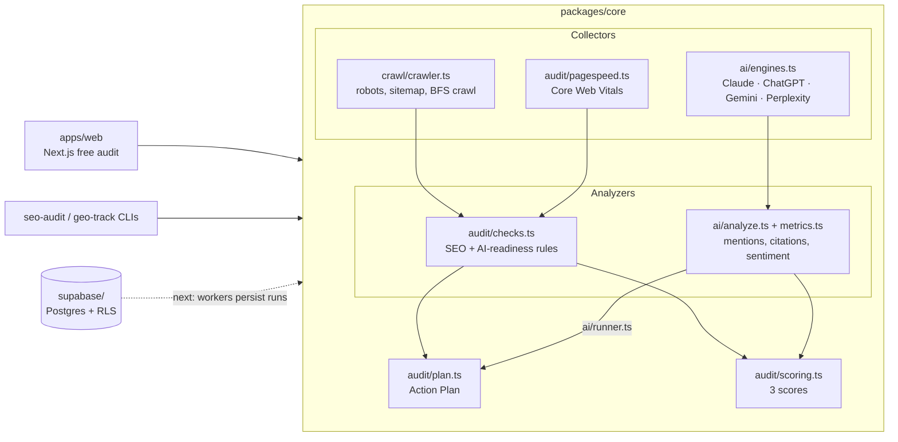

# Architecture

How the PRD's "three collectors → three analyzers → one Action Plan" design maps onto this
repo, what's built, and what's next. Read [PRD.md](PRD.md) first.

## Packages

| Path | What it is |
| --- | --- |
| `packages/core` | Framework-free TypeScript library: crawler, audit rules, scoring, Action Plan, GEO tracking. Everything else is a thin shell over it. |
| `apps/web` | Next.js App Router + Tailwind. Today: the free audit (PRD use case 1). |
| `supabase/migrations` | Postgres schema for the PRD data model, with per-workspace row-level security. |
| `docs/` | PRD snapshot, this file, the MVP plan, the check catalog. |

## Key decisions

**One engine, many shells.** All logic lives in `@seobuilder/core` so the web app, CLIs and
future Railway workers run the same code. Core has no framework or database dependency; it
takes inputs and returns plain objects shaped like the database tables.

**Fetch + cheerio crawler, not Playwright (yet).** Raw HTML is what most AI crawlers see, so
fetching without a browser *is* the AI-readiness test ("content readable without
JavaScript"). Playwright workers come with the P1 "JavaScript rendering check", which compares
rendered and raw text.

**Crawler etiquette (PRD non-functional).** Identifies as `SEOBuilderBot`, obeys robots.txt for
its own user agent, crawls same-host only, 4 workers with a 250 ms delay each by default,
3 MB per page cap, 15 s timeout. External links get a HEAD check (GET fallback) and only
404/410/5xx count as broken, because many sites answer bots with 403 while working for people.

**SSRF guard.** The web app fetches URLs users type, so `politeFetch` resolves every hostname
(including every redirect hop) and refuses loopback, private, link-local, CGNAT and metadata
addresses. Known gap: a DNS-rebinding attacker could return a public IP to our lookup and a
private one to the connection. Before taking public traffic, pin the resolved IP into the
connection (custom undici dispatcher) or run crawls from an egress-restricted worker.

**Scores.** Each issue deducts `impact × confidence × severity weight` with diminishing returns
(`100·e^(−penalty/scale)`), so one bad area can't zero a score. AI Visibility is on-site
readiness until prompt tracking has data, then it's weighted toward observed mention and
citation rates as the sample grows (full weight at ~60 answers). Search Visibility stays
empty until rank data exists, rather than showing a made-up number. The constants are first
guesses to tune against real sites.

**Action Plan.** `priority = impact × confidence ÷ effort`, ×1.25 for tasks that help SEO and
GEO (PRD). Task ids are stable per site and issue type, so statuses survive re-crawls;
`reconcilePlan` closes tasks whose issue disappeared and reopens Done tasks whose issue came
back (PRD: "marking Done triggers a re-check").

**AI engines: official APIs only.** Each adapter asks with web search on, so answers carry
citations like the consumer apps do. Claude uses the Anthropic SDK (`claude-opus-5-5` by
default, overridable with `ANTHROPIC_MODEL`, with server-side refusal fallback enabled); OpenAI,
Gemini and Perplexity use their REST APIs. Engines without a key are skipped. Google AI
Overviews needs a SERP data provider and Copilot has no suitable public API, so both wait on
the provider decision (PRD open question). The UI must keep saying that API answers can
differ from what people see in the apps.

**Answer parsing is deterministic for now.** Mentions use word-boundary name/alias/domain
matching; position is order of first mention; sentiment is a small lexicon over the sentences
naming the entity; brand-fact checks look for the expected value near the fact's label. The
PRD calls for LLM parsing: swap `analyzeAnswer` for an LLM call with structured output, and keep
the deterministic version as the test oracle and fallback.

**Noise handling.** Every rate carries its sample size and a 95% Wilson interval, and the
"engine never mentions you" alert fires only when the upper bound is under 30% with at least
10 answers. `--repeats` reruns each prompt to average out answer randomness.

## What persists where (next step)

Today the web app runs an audit per request and keeps nothing. The next slice (see
[mvp-plan.md](mvp-plan.md)) adds Supabase auth, writes `crawls/pages/issues/tasks/score_snapshots`
from a worker, and schedules re-crawls and prompt runs.
